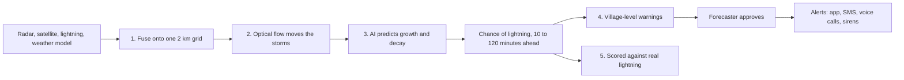

# Vajra

Vajra warns villages about lightning before the first strike.

Every 10 minutes, it predicts lightning and thunderstorms up to 2 hours ahead on a 2 km grid.
It reads weather radar, satellite images, lightning sensors and weather model data together.
A forecaster approves every warning before it goes out.

Team LowBattery built Vajra for Smart India Hackathon 2026, problem statement SIH26072,
set by the India Meteorological Department (IMD).

## Why it matters

Lightning killed 2,825 people in India in 2024, more than any other natural cause
(National Crime Records Bureau). Today's warnings either come every 3 hours for whole districts,
or track storms that are already flashing. A new storm is invisible until its first strike.
Radar and satellites see that storm building first. Vajra uses that gap.

## How it works



1. **Fuse.** Clean the data and put every source on one grid, every 10 minutes.
2. **Motion.** Optical flow carries existing storms forward. Physics does this well.
3. **Evolution.** A neural network (a U-Net with a ConvGRU encoder) predicts storms forming,
   growing and dying, which optical flow cannot.
4. **Warnings.** Risk is the chance of lightning times how many people are likely outdoors.
   Vajra drafts warning polygons in IMD's colour codes and sends approved ones as
   Common Alerting Protocol (CAP) alerts, the format NDMA's SACHET platform takes.
5. **Verification.** Every forecast is scored against the lightning that actually happened.

## What works today

| Part | Module |
|---|---|
| Synthetic storms for testing | `vajra.data.synthetic` |
| Streaming reader for SEVIR, a public US archive of radar, satellite and lightning data | `vajra.data.sevir` |
| Optical flow and three baselines: persistence, lightning-only tracking, radar extrapolation | `vajra.nowcast` |
| The neural network, with lead time as an input and sensor dropout for missing data | `vajra.model` |
| Calibration, so a 30% forecast comes true about 30% of the time | `vajra.model.calibration` |
| Scores: critical success index, fractions skill score, Brier score, reliability, minutes of warning | `vajra.verify` |
| Risk, warning polygons and CAP alerts in English and Hindi | `vajra.warn` |

## What comes next

1. Score the baselines on SEVIR storms. These give the first real numbers.
2. Train the network on SEVIR, then fine-tune it on Indian data once IMD and the
   Indian Institute of Tropical Meteorology (IITM) share radar and lightning data.
3. A FastAPI service for forecasts, warnings and a CAP feed.
4. A web console for forecasters, built with React, MapLibre GL and deck.gl.

## Try it

```bash
pip install -e ".[test]"        # add ",model" for PyTorch and ",sevir" for SEVIR
pytest
vajra evaluate                   # scores the baselines on synthetic storms
vajra cap-example                # prints an example alert, marked as an exercise
```

`vajra evaluate` uses synthetic storms. Its numbers check that the code works.
They say nothing about skill on real weather.

## Data

- **SEVIR** (Storm Event Imagery dataset): public, streamed from AWS without a full download.
- **IMD Doppler weather radar, INSAT-3DR and INSAT-3DS satellite images, IITM lightning data:**
  not public yet. Vajra reads them through the same interfaces once access is granted.
- **NASA Black Marble** night lights: the base map in the demo.

## Demo

`demo/index.html` is the replay from our video: 13 May 2026, Uttar Pradesh. Open it in a current
browser with an internet connection, which it needs for the map library and fonts.

## Repository layout

```
src/vajra/
  data/       synthetic storms and the SEVIR reader
  nowcast/    optical flow and baselines
  model/      the neural network, losses and calibration
  verify/     scores
  warn/       risk, polygons and CAP alerts
  cli.py      the `vajra` command
tests/        one test file per module
demo/         the interactive replay
```

## Licence

MIT. See `LICENSE`.
